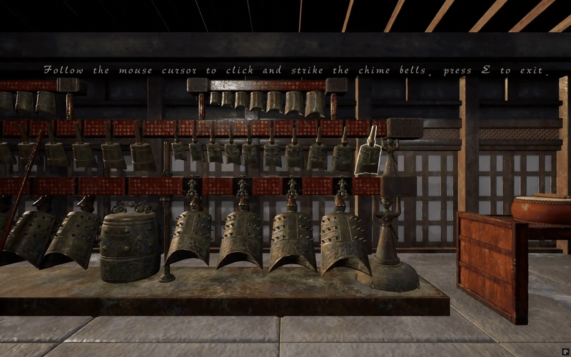
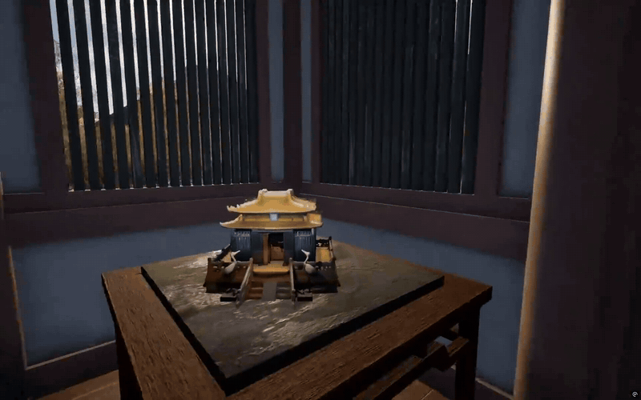
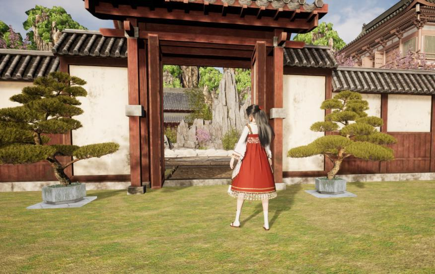
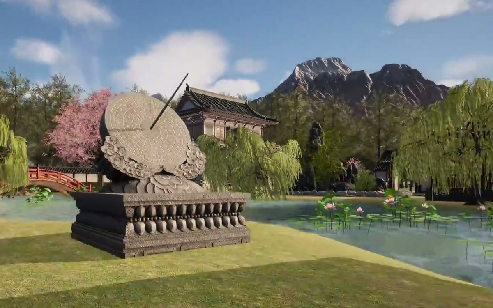
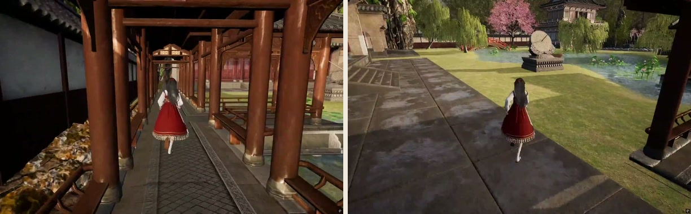

Before downloading the programme, you may wish to watch the video at the link provided, which gives a brief overview of how the application looks when it is running.

[Watch the Project Demonstration Video](https://4604581.ma3you.cn/html/content_show/index.html?v=20250213&article_id=Oz00104#/)

## Download the Windows Application

[Download Windows Application (v1.0.0)](https://github.com/xikun1/Ancient-Physics-Interactive-Learning/releases/tag/v1.0.0)

Download all three archive volumes from the Release Assets section. Extract the `.7z.001` file using 7-Zip, then launch `Museum.exe` from the extracted application folder.

## Interaction Highlights (Selected Demos) / 交互亮点（部分展示）

Animated excerpts from the project demonstration video. Watch the full video above for audio and the complete walkthrough.

### 1. Sundial interaction / 日晷互动

Use the sundial's shadow to choose a time range, then see the answer explained.

### 2. AI-assisted learning / AI 智能问答

Ask the in-world assistant how ancient instruments work and follow its explanations.

### 3. Chime-bell interaction / 编钟演奏

Play the ancient chime bells and see musical-note and achievement feedback.

### 4. Cannon firing / 火炮发射

Trigger the cannon exhibit and observe its firing effect.

### 5. Friction fire-making / 钻木取火

Complete the fire-making interaction and see the wood ignite.

### 6. The Lightning Hall / 雷火炼电

Watch lightning strike the Golden Hall model and see the hidden card appear.

## 中式园林设计思想（部分）

以下根据项目论文第 2.3 节（第 21 至 22 页）整理。配图取自论文图 2.12 和项目演示视频。

### 开门见山，先藏后露

园门内的假山遮住通往庭院深处的视线。游人入门先见山石，绕过假山才逐步看见院落与展厅。这样一藏一露，让新的景致随着行走逐渐显现。

*门洞框住假山，只露出一角院景（论文图 2.12）。*

### 远山围合，近水开敞

项目以远山为背景，让山脊成为庭院的自然边界。建筑前留出开阔水面，从近处的池水望向岸边的屋顶和远处的山脊，园景就有了远近层次。

### 曲径连廊，移步换景

庭院借鉴苏州园林的非对称布局，用曲折的游路、相连的廊道和跨水小桥串起不同观景点。沿廊行走时，从柱间可以瞥见部分园景。转出廊道，水面和庭院随即展开。

*左图为廊内视角，右图为同一条游线上出廊后的视角。*
