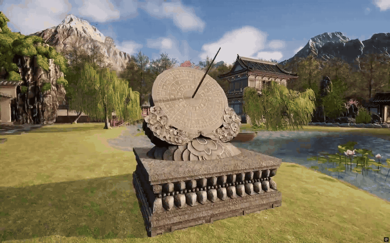
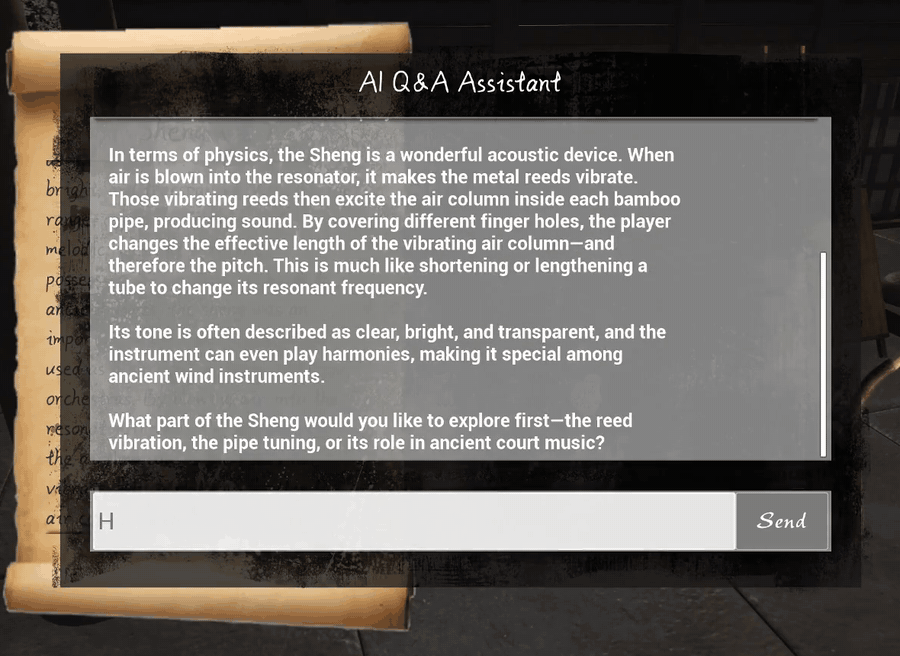
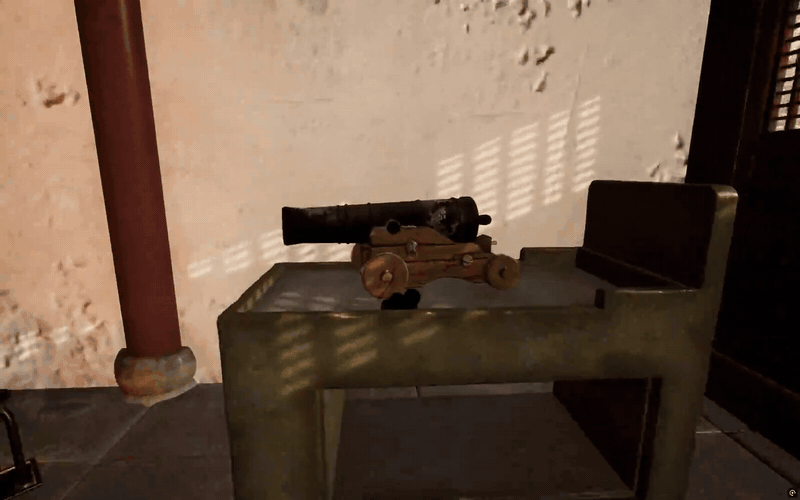
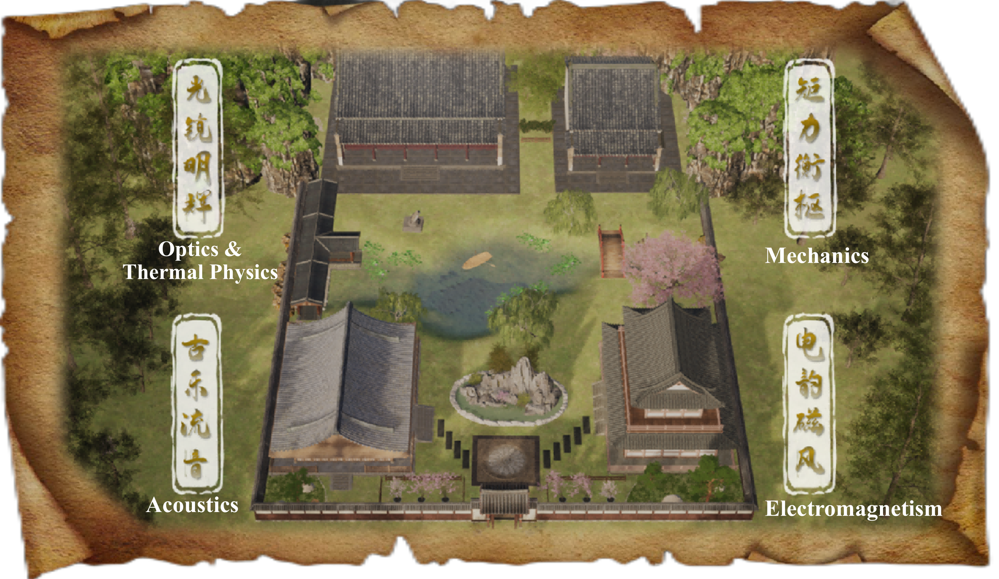

Before downloading the programme, you may wish to watch the video at the link provided, which gives a brief overview of how the application looks when it is running.

[Watch the Project Demonstration Video](https://4604581.ma3you.cn/html/content_show/index.html?v=20250213&article_id=Oz00104#/)

## Download the Windows Application

[Download Windows Application (v1.0.0)](https://github.com/xikun1/Ancient-Physics-Interactive-Learning/releases/tag/v1.0.0)

Download all three archive volumes from the Release Assets section. Extract the `.7z.001` file using 7-Zip, then launch `Museum.exe` from the extracted application folder.

## Interaction Highlights (Selected Demos) / 交互亮点（部分展示）

Animated excerpts from the project demonstration video. Watch the full video above for audio and the complete walkthrough.

### 1. Sundial interaction / 日晷互动

Use the sundial's shadow to choose a time range, then see the answer explained.

<picture>
  <source type="image/avif" srcset="assets/animations/sundial.avif">
  
</picture>

### 2. AI-assisted learning / AI 智能问答

Ask the in-world assistant how ancient instruments work and follow its explanations.

<picture>
  <source type="image/avif" srcset="assets/animations/ai-learning-assistant.avif">
  
</picture>

### 3. Chime-bell interaction / 编钟演奏

Play the ancient chime bells and see musical-note and achievement feedback.

<picture>
  <source type="image/avif" srcset="assets/animations/chime-bell-interaction.avif">
  
</picture>

### 4. Cannon firing / 火炮发射

Trigger the cannon exhibit and observe its firing effect.

<picture>
  <source type="image/avif" srcset="assets/animations/cannon-firing.avif">
  
</picture>

### 5. Friction fire-making / 钻木取火

Complete the fire-making interaction and see the wood ignite.

<picture>
  <source type="image/avif" srcset="assets/animations/friction-firemaking.avif">
  
</picture>

### 6. The Lightning Hall / 雷火炼电

Watch lightning strike the Golden Hall model and see the hidden card appear.

<picture>
  <source type="image/avif" srcset="assets/animations/lightning-hall.avif">
  
</picture>

## Chinese Garden Design (Selected Examples) / 中式园林设计思想（部分）

The garden draws on the design and layout principles of Suzhou's classical gardens.

### 1. Entrance Rockery / 开门见山，先藏后露

Look through the entrance gate to see how the rockery screens most of the courtyard. As you walk around the rocks, the courtyard and exhibition halls gradually come into view. The view illustrates the Chinese idiom *kāi mén jiàn shān* (开门见山), which literally means “open the door and see the mountain.”

<a href="assets/garden/entrance-rockery.avif?raw=1">
  <picture>
    <source type="image/avif" srcset="assets/garden/entrance-rockery.avif">
    
  </picture>
</a>

### 2. Mountain Backdrop and Open Water / 远山围合，近水开敞

Look across the open pond towards the buildings on its banks and the mountains beyond. The water opens up the foreground, while the distant ridges frame the garden.

<a href="assets/garden/waterside-and-mountains.avif?raw=1">
  <picture>
    <source type="image/avif" srcset="assets/garden/waterside-and-mountains.avif">
    
  </picture>
</a>

### 3. Changing Views Along the Path / 曲径连廊，移步换景

Follow the winding paths, linked corridors, and small bridges of the asymmetrical courtyard, inspired by classical Suzhou gardens. The paired views show how the scene opens up as you step out of the corridor.

<a href="assets/garden/changing-views.avif?raw=1">
  <picture>
    <source type="image/avif" srcset="assets/garden/changing-views.avif">
    
  </picture>
</a>

### 4. Interactive Map Navigation / 地图导航

Open the in-game map to locate the four exhibition halls. Click a hall's button on the map to teleport directly to its entrance and continue exploring.

<a href="assets/garden/interactive-map.png">
  <picture>
    <source type="image/avif" srcset="assets/garden/interactive-map.avif">
    
  </picture>
</a>
