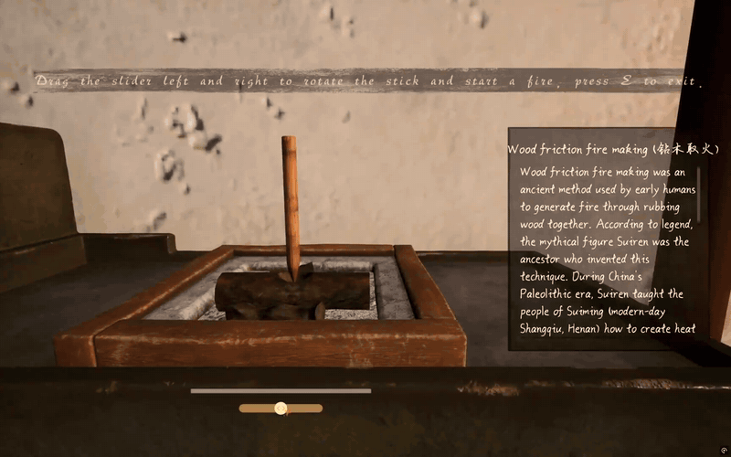

Before downloading the programme, you may wish to watch the video at the link provided, which gives a brief overview of how the application looks when it is running.

[Watch the Project Demonstration Video](https://4604581.ma3you.cn/html/content_show/index.html?v=20250213&article_id=Oz00104#/)

## Download the Windows Application

[Download Windows Application (v1.0.0)](https://github.com/xikun1/Ancient-Physics-Interactive-Learning/releases/tag/v1.0.0)

Download all three archive volumes from the Release Assets section. Extract the `.7z.001` file using 7-Zip, then launch `Museum.exe` from the extracted application folder.

## Interaction Highlights (Selected Demos) / 交互亮点（部分展示）

Animated excerpts from the project demonstration video. Watch the full video above for audio and the complete walkthrough.

### 1. Sundial interaction / 日晷互动

Use the sundial's shadow to choose a time range, then see the answer explained.

### 2. AI-assisted learning / AI 智能问答

Ask the in-world assistant how ancient instruments work and follow its explanations.

### 3. Chime-bell interaction / 编钟演奏

Play the ancient chime bells and see musical-note and achievement feedback.

### 4. Cannon firing / 火炮发射

Trigger the cannon exhibit and observe its firing effect.

### 5. Friction fire-making / 钻木取火

Complete the fire-making interaction and see the wood ignite.

### 6. The Lightning Hall / 雷火炼电

Watch lightning strike the Golden Hall model and see the hidden card appear.

